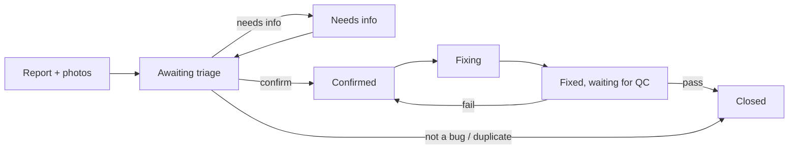

# issue-board-mcp

A connector that lets Claude talk to **your own issue board's MCP server** using a personal token.
QC report bugs by talking to Claude. The team that fixes them lets Claude read the queue, look at the screenshots, move issues along and attach the PR link, without opening the board.

This repo holds **no rules or permissions** — the server you connect to decides everything (who may do what, which status changes are allowed).

[ภาษาไทย](README.md)

<picture>
  <source media="(prefers-color-scheme: dark)" srcset="docs/images/board-dark.png">
  
</picture>

<sub>Example image (a mockup with made-up data). Your board may look different.</sub>

## Install

### Claude Code

```text
/plugin marketplace add captainkie/issue-board-mcp
/plugin install issue-board@issue-board-mcp
```

You will be asked for two values:

- **Server URL** — must start with `https://`, e.g. `https://board.example.com/mcp`
- **Personal token** — e.g. `qat_EXAMPLE…` (stored in your OS keychain)

Then run `/mcp` and check that `issue-board` shows as connected.

### Claude Desktop

1. Download `issue-board.mcpb` from **[Releases](https://github.com/captainkie/issue-board-mcp/releases)**.
2. Double-click it and fill in the Server URL and token.
3. Turn the extension on.

## Issue lifecycle



- A triager first decides whether it is a real bug, then hands it to the owning team.
- Whoever marks an issue fixed must attach a PR or build link.
- **QC closes issues.** Claude cannot close one itself. The server enforces this, not this connector.

## Things you can say

What you can do depends on **your role on the server**. You can start by asking Claude "what can I do?".

**QC / reporters**

- "Report a new bug: the profile page does not show the name". Claude asks for each missing field and gives you an upload link for photos.
- "Show my issues that are waiting for more info"
- "Verify the issues that were fixed". Pass closes the issue; fail sends it back to be fixed.
- "Run the test cases for screen A1". Cases run one at a time, and a failure becomes a draft issue right away.

**Triagers / fixers**

- "Show my queue" or "What changed since last time?"
- "Show QA-12 with its photos"
- "Confirm QA-12 for the API team" · "QA-12 needs info: which device?"
- "Start fixing QA-12", then when done "QA-12 is fixed, PR https://git.example.com/app/pull/42"

**Finding a screen**: mix a section number and a name in any order, e.g. `A7 agreement` or `a8 notif`. This works if your server supports it.

### Ready-made prompts

If your server provides them, they appear in Claude Code as `/mcp__issue-board__<name>` (type `/mcp__` to see the exact list):

| Prompt | What it starts |
| --- | --- |
| `report_bug` | report a new bug ("แจ้งบั๊กใหม่") |
| `test_screen` | run the test cases for a screen ("เทสตาม test case ของจอ…") |
| `my_needs_info` | issues waiting for more information from you ("ดูข้อของฉันที่รอเติมข้อมูล") |
| `verify_fixed` | check fixes that are waiting for QC ("ตรวจข้อที่แก้แล้ว (รอ QC)") |

## Security

- The token is personal. **Never paste it into a chat** or share it. Everything Claude does with it shows on the board under your name.
- If it leaks, revoke it on your board's token page right away.
- The Desktop extension requires `https://` (except localhost) because the token travels with every request.
- The connector only forwards requests. It keeps no issue data on your machine.

License: MIT
