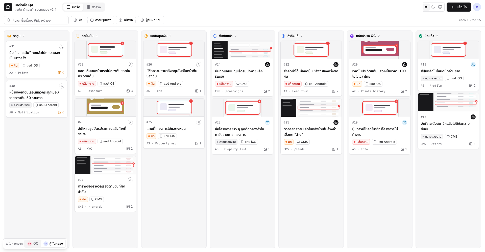
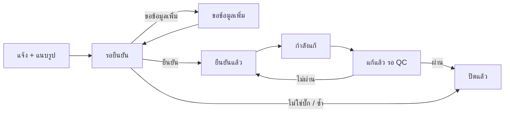

# issue-board-mcp

ตัวเชื่อม Claude เข้ากับ MCP server ของ **บอร์ดแจ้งปัญหา (issue board) ของคุณเอง** ด้วย token ส่วนตัว
QC แจ้งบั๊กด้วยการคุยกับ Claude ส่วนทีมที่แก้ให้ Claude อ่านคิว ดูรูป ย้ายสถานะ และแนบลิงก์ PR ได้เลย โดยไม่ต้องเปิดบอร์ดเอง

รีโปนี้ **ไม่มีกติกาหรือสิทธิ์ใด ๆ** — server ที่คุณเชื่อมต่อเป็นผู้ตัดสินทุกอย่าง (ใครทำอะไรได้ เปลี่ยนสถานะไหนได้)

[English](README.en.md)

<picture>
  <source media="(prefers-color-scheme: dark)" srcset="docs/images/board-dark.png">
  
</picture>

<sub>ภาพตัวอย่าง (mockup ข้อมูลสมมติ) — หน้าตาจริงขึ้นกับบอร์ดของคุณ</sub>

## ติดตั้ง

### Claude Code

```text
/plugin marketplace add captainkie/issue-board-mcp
/plugin install issue-board@issue-board-mcp
```

ระบบจะถาม 2 ค่า:

- **Server URL** — ต้องขึ้นต้นด้วย `https://` เช่น `https://board.example.com/mcp`
- **Personal token** — เช่น `qat_EXAMPLE…` (เก็บใน keychain ของเครื่อง)

จากนั้นพิมพ์ `/mcp` เพื่อเช็กว่า `issue-board` เชื่อมต่อแล้ว

### Claude Desktop

1. ดาวน์โหลด `issue-board.mcpb` จากหน้า **[Releases](https://github.com/captainkie/issue-board-mcp/releases)**
2. ดับเบิลคลิกไฟล์ แล้วกรอก Server URL และ token
3. เปิดใช้งานส่วนขยาย

## วงจรของ issue



- ผู้คัดกรองตัดสินก่อนว่าเป็นบั๊กจริง แล้วค่อยส่งให้ทีมที่รับผิดชอบแก้
- ทีมที่แก้ต้องแนบลิงก์ PR หรือ build ตอนบอกว่า "แก้แล้ว"
- **QC เป็นคนปิด** — Claude ปิดข้อเองไม่ได้ (server เป็นคนบังคับ ไม่ใช่ตัวเชื่อมนี้)

## พิมพ์อะไรได้บ้าง

สิ่งที่ทำได้ขึ้นกับ **บทบาทของคุณบน server** — ถาม Claude ว่า "ฉันทำอะไรได้บ้าง" ก่อนเริ่มได้เลย

**QC / ผู้แจ้ง**

- "แจ้งบั๊กใหม่: หน้าโปรไฟล์ชื่อไม่ขึ้น" — Claude ถามทีละช่องที่ยังขาด และให้ลิงก์แนบรูป
- "ดูข้อของฉันที่รอเติมข้อมูล"
- "ตรวจข้อที่แก้แล้ว" — ผ่าน = ปิด · ไม่ผ่าน = กลับไปให้ทีมแก้ใหม่
- "เทสตาม test case ของจอ A1" — ทีละข้อ ไม่ผ่านได้ร่าง issue ให้ทันที

**ผู้คัดกรอง / ทีมที่แก้**

- "ดูคิวของฉัน" หรือ "มีอะไรเปลี่ยนตั้งแต่ครั้งก่อน"
- "ขอรายละเอียด QA-12 พร้อมรูป"
- "ยืนยัน QA-12 ให้ทีม API" · "QA-12 ขอข้อมูลเพิ่ม: เครื่องรุ่นอะไร"
- "เริ่มแก้ QA-12" แล้วพอเสร็จ "QA-12 แก้แล้ว PR https://git.example.com/app/pull/42"

**ค้นหาจอ** — พิมพ์เลขหมวดกับชื่อจอปนกันได้ เช่น `A7 agreement` หรือ `a8 notif` (ถ้า server ของคุณรองรับ)

### Prompt สำเร็จรูป

ถ้า server มี prompt ให้ ใน Claude Code จะขึ้นเป็น `/mcp__issue-board__<ชื่อ>` (พิมพ์ `/mcp__` เพื่อดูรายการจริง):

| Prompt | ใช้ทำอะไร |
| --- | --- |
| `report_bug` | แจ้งบั๊กใหม่ |
| `test_screen` | เทสตาม test case ของจอ… |
| `my_needs_info` | ดูข้อของฉันที่รอเติมข้อมูล |
| `verify_fixed` | ตรวจข้อที่แก้แล้ว (รอ QC) |

## ความปลอดภัย

- token เป็นของคุณคนเดียว **ห้ามวางในแชต** หรือส่งให้ใคร — ทุกอย่างที่ Claude ทำผ่าน token จะขึ้นเป็นชื่อคุณบนบอร์ด
- ถ้า token หลุด ให้เพิกถอนที่หน้า token ของบอร์ดทันที
- ส่วนขยาย Desktop บังคับ `https://` (ยกเว้น localhost) เพราะ token ถูกส่งไปกับทุกคำขอ
- ตัวเชื่อมนี้ส่งต่อคำขอเท่านั้น ไม่เก็บข้อมูล issue ไว้ที่เครื่อง

License: MIT
